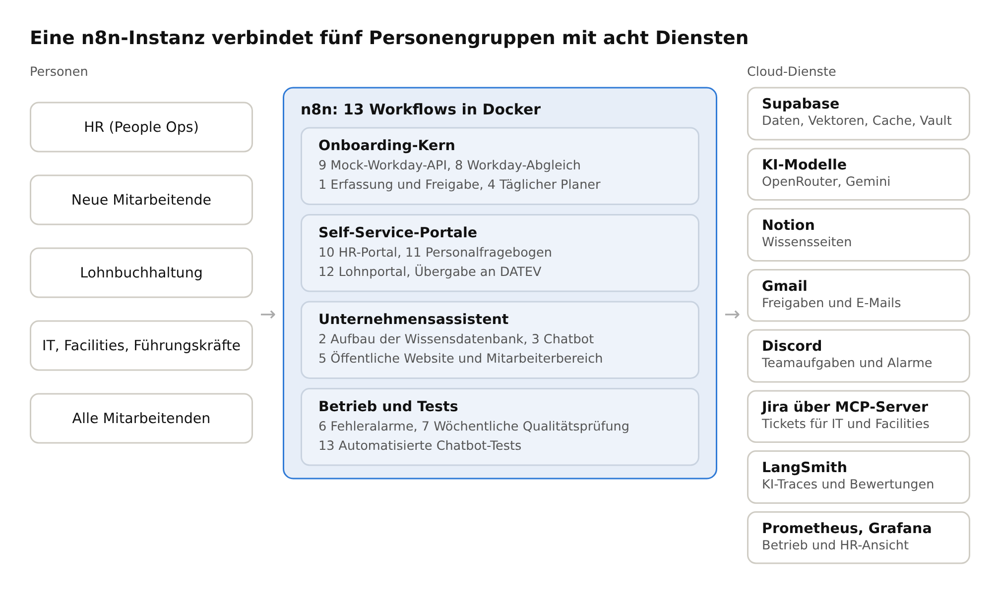
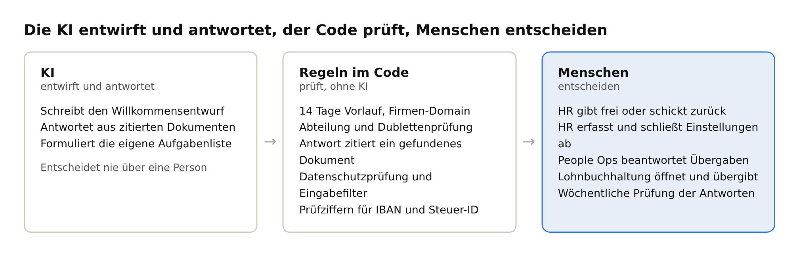
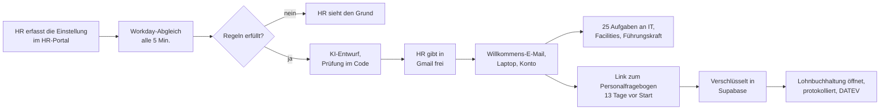

[English](README.md) · **Deutsch**

# BrewTec Onboarding-Agent für neue Mitarbeitende

*Projektname: Employee Onboarding Journey Agent*

Ein KI-gestützter Onboarding-Agent, gebaut in **n8n** für den fiktiven Kaffeemaschinenhersteller BrewTec GmbH (84 Mitarbeitende, Köln und Leverkusen). Er begleitet neue Mitarbeitende mit einem einzigen Klick von HR vom HR-System bis zum ersten Gehalt. Außerdem beantwortet er die Fragen aller Mitarbeitenden zum Unternehmen aus offiziellen Dokumenten und nennt dabei immer die Quelle.

## Was der Agent macht

| Für | Der Agent |
|---|---|
| **HR (People Ops)** | Holt neue Mitarbeitende aus dem HR-System (Mock-Workday-API), prüft sie mit festen Regeln, lässt die Willkommens-E-Mail von der KI entwerfen und wartet auf die Freigabe durch HR |
| **Neue Mitarbeitende** | Sendet ihnen eine Willkommens-E-Mail mit persönlichem Code, erfasst ihre Bank- und Steuerdaten über ein sicheres Einmal-Formular und beantwortet Fragen zu ihren eigenen Aufgaben |
| **IT, Facilities, Führungskräfte** | Postet ihre Onboarding-Aufgaben in Discord, mit einer täglichen Übersicht überfälliger Aufgaben und einer Prüfung der Bereitschaft für den ersten Tag |
| **Lohnbuchhaltung** | Zeigt die verschlüsselten Lohndaten in einem eigenen Portal, protokolliert jeden Zugriff und dokumentiert die Übergabe an DATEV |
| **Alle Mitarbeitenden** | Ein Unternehmensassistent auf der Website, der aus der Wissensdatenbank auf Deutsch oder Englisch antwortet und an People Ops übergibt, statt zu raten |

**Die KI entscheidet nichts über Menschen.** Regeln im Code prüfen jede Einstellung, HR gibt jede ausgehende Nachricht frei, und die KI schreibt nur Entwürfe und antwortet aus zitierten Dokumenten. Beschäftigung ist nach dem EU AI Act ein Hochrisikobereich, deshalb ist diese Grenze Teil des Designs.

## Der Ablauf auf einen Blick

Weitere Diagramme, darunter das UML-Aktivitätsdiagramm mit einer Bahn pro Rolle, stehen in [Architektur](docs/ARCHITECTURE.md) (auf Englisch).

## Highlights

- **13 n8n-Workflows**: Erfassung und Freigabe, Aufbau der Wissensdatenbank, Unternehmensassistent, täglicher Planer, Website, Fehleralarme, wöchentliche Qualitätsprüfung, Workday-Anbindung, Mock-Workday-API, HR-Portal, Personalfragebogen, Lohnportal, automatisierte Chatbot-Tests
- **Sensible Daten von Anfang an geschützt**: IBAN, Steuer-ID und Sozialversicherungsnummer mit pgcrypto (AES-256) verschlüsselt, Schlüssel im Supabase Vault, HR sieht nur eine maskierte IBAN, jeder Zugriff der Lohnbuchhaltung wird protokolliert, keine n8n-Ausführungsdaten für diese Workflows
- **Drei Datenschutzebenen im Assistenten**: Anfragen zu Daten anderer Personen werden vor der KI abgelehnt, eingetippte ID-Nummern entfernt und nie gespeichert, Antworten müssen ein gefundenes Dokument zitieren
- **Gedächtnis mit Grenzen**: Chat-Gedächtnis der letzten 8 Wortwechsel pro Chat, ein Antwort-Cache für wiederholte allgemeine Fragen (7 Tage, nie persönliche oder Gesundheitsfragen), ein bereinigtes Chat-Protokoll, das nach 90 Tagen gelöscht wird. Details in [Architektur](docs/ARCHITECTURE.md#memory-cache-and-chat-storage)
- **Zuverlässigkeit**: Antwort-Cache, Wiederholungen, Circuit Breaker, Rate Limits, freundliche Ersatzmeldungen, Fehler-Workflow in einen Dev-Ops-Kanal, täglicher Health Check
- **Beobachtbarkeit**: LangSmith für die KI (Traces und Alarme), wöchentliche Qualitätswerte in Supabase, Prometheus und Grafana für den n8n-Betrieb sowie eine Grafana-Geschäftsansicht für HR auf Basis schreibgeschützter Übersichtsviews
- **Automatisierte Tests**: Workflow 13 schickt 39 Testfragen an den Assistenten, prüft jede Antwort und versendet einen Excel-Bericht per E-Mail
- **Sicherheit**: persönlicher Website-Login für alle Mitarbeitenden (bcrypt, Sperre, Login-Protokoll), getrennte Logins für HR und Lohnbuchhaltung, HMAC-signierte (Hash-based Message Authentication Code) Seiten-Tokens gegen gefälschte Formulareingaben, gehashte Einmal-Links mit Code-Sperre

## Ergebnisse

| Messgröße | Ergebnis |
|---|---|
| Funktions- und Zuverlässigkeitstests | Funktions- und Zuverlässigkeitstestfälle manuell getestet, mit Screenshots der Ergebnisse. Siehe [Tests](docs/TESTING.md) |
| Automatisierte Chatbot-Tests | 36 von 39 im ersten Lauf, **39 von 39 (100 %)** nach Behebung einer Lücke im Prompt und eines Zitierfehlers, die die Tests gefunden haben |
| Wöchentliche Antwortqualität | Anfangs 30 % (Limits des KI-Anbieters), 90 % nach den Korrekturen |
| Antwortzeit des Chatbots | 24 bis 33 s mit dem kostenlosen Gemini-Tarif, etwa 2,7 s nach dem Wechsel des Chatmodells zu OpenRouter |
| Ende zu Ende | Eine Einstellung (Clara Neumann) lief von der HR-Erfassung bis zur DATEV-Übergabe mit einem einzigen Freigabeklick von HR |
| Chatbot-Tests mit mehreren Fragen pro Chat | **10 von 10** in 3 echten Chats nach der Korrektur des wichtigsten Fehlerfalls unten (Lauf 13515, 3. Nov. 2026) |
| Szenariotests | **26 von 26** bestanden, darunter alle 10 Sicherheitsfälle und alle 3 bewussten Fehlerfälle. Siehe [Scenario tests](docs/SCENARIO_TESTS.md) |
| Gemessen im Ende-zu-Ende-Test | Ein Onboarding-Lauf braucht **17,7 s** Maschinenzeit, eine Antwort des Assistenten kostet **0,00084 USD** (etwa 2.300 Tokens) und dauert etwa 2 s, 4 von 323 Läufen schlugen am Testtag fehl (1,24 %). Siehe [ROI](docs/ROI.md#measured-in-the-end-to-end-test-2-nov-2026) |
| Business Case | Etwa 900 € Einsparung pro Monat, Amortisation nach etwa 7,5 Monaten (Szenariowerte für die HR-Zeit, gemessene KI-Kosten). Siehe [Business case](docs/BUSINESS_CASE.md) |

**Wichtigster Fehlerfall:** In längeren Chats antwortete die KI manchmal aus dem Chat-Gedächtnis ohne neue Suche. Die Antwortprüfung erkannte das und übergab an People Ops, es wurde also keine falsche Antwort angezeigt, aber People Ops bekam unnötige Anfragen. Behoben durch eine Prompt-Regel und Tests mit mehreren Fragen pro Chat, die jetzt 10 von 10 bestehen. Ein fester Suchschritt ist geplant. Siehe [Improvement plan](docs/IMPROVEMENT_PLAN.md).

## Eine Einstellung von Anfang bis Ende

Livetest am 3. Nov. 2026 mit der fiktiven Neueinstellung **Ayşe Yıldız** (Backend Developer, Engineering, Köln, Start 30. Nov. 2026): Workday-Eintrag, eine Freigabe-E-Mail für HR mit dem vorgeschlagenen Konto `ayse.yildiz@brewtec.de` (Bias-Test T08 live), Willkommens-E-Mail mit persönlichem Code, Jira-Tickets für IT und Facilities, Aufgaben für die Führungskraft in Discord, persönlicher Einmal-Link zum Lohnformular, maskierte IBAN für HR, verschlüsselte Speicherung in der Datenbank, persönlicher Website-Login und der Assistent, der mit ihrem Code nur ihre eigenen Aufgaben zeigt und im selben Chat eine Richtlinienfrage mit Quelle beantwortet. Alle 15 Screenshots stehen in der [englischen README](README.md#one-hire-end-to-end) und in [`docs/images/end_to_end`](docs/images/end_to_end).

## Grenzen und Annahmen

- **Fiktives Unternehmen, synthetische Daten.** BrewTec, Mitarbeitende, Einstellungen und Richtlinien sind erfunden. Test-Einstellungen nutzen Platzhalter-E-Mail-Adressen.
- **Simulationen.** Workday ist eine Mock-API (Workflow 9) mit dem echten Berichtsformat. Arbeitskonten und Laptop-Bestand werden in Supabase simuliert. Die DATEV-Übergabe ist eine manuelle Markierung „übergeben“.
- **Angenommen, nicht gemessen.** Die 6 Stunden pro Einstellung heute, die 1 Stunde nach der Automatisierung, 4 Einstellungen pro Monat und 45 € pro Stunde sind Szenariowerte. Testergebnisse, Laufzeiten und KI-Kosten sind gemessen (LangSmith, Prometheus und Grafana, 2. Nov. 2026).
- **Nicht verlässlich bezifferbar.** Die Kosten einer Einstellung ohne funktionierende Zugänge und der Wert weniger wiederholter Fragen fehlen in der ROI-Rechnung.
- **Läuft auf einem Laptop.** Die Demo läuft in Docker unter Windows hinter einem Cloudflare Quick Tunnel, daher gibt es keinen dauerhaften Link. Hosting in Deutschland ist geplant.
- **Offen vor echtem Einsatz.** DSFA, Betriebsvereinbarung, Bias-Prüfung der KI-Willkommensentwürfe, automatisches Löschen der Lohndaten und ein erneuter Live-Lauf der Tests mit mehreren Fragen pro Chat.

## Technologie

| Bereich | Software | Version | Wofür |
|---|---|---|---|
| Automatisierung | n8n | 2.37.10 (Docker-Image `docker.n8n.io/n8nio/n8n:2.37.10`, externe Task Runner) | Alle 13 Workflows |
| Laufzeit | Docker Desktop | 4.87.0 | Betrieb von n8n, Prometheus und Grafana unter Windows |
| Datenbank | Supabase PostgreSQL | 17.11 | Einstellungen, Aufgaben, Chat-Protokoll, Antwort-Cache, verschlüsselte Lohndaten |
| Datenbank | pgvector | 0.8.2 | Vektorsuche für die Wissensdatenbank |
| Datenbank | pgcrypto | 1.3 | AES-256-Verschlüsselung der Lohndaten, bcrypt für Website-Passwörter |
| Datenbank | Supabase Vault | Cloud-Dienst von Supabase | Schlüssel für die Lohndaten |
| KI | OpenRouter | `google/gemini-2.5-flash` | Chatmodell des Unternehmensassistenten (Workflow 3) |
| KI | Google Gemini | Standardmodell des n8n-Gemini-Knotens (LangSmith zeigt `gemini-3.6-flash` und `gemini-3.7-flash`) | Entwurf der Willkommens-E-Mail und Jira-Ticket-Agent (Workflow 1) |
| KI | Google Gemini | `gemini-embedding-001` | Vektoren der Wissensdatenbank (Workflows 2 und 3) |
| Wissensdatenbank | Notion | Cloud-Dienst | Richtlinienseiten des Unternehmens |
| Kommunikation | Gmail | Cloud-Dienst (OAuth) | Willkommens-E-Mails, HR-Freigaben, Berichte |
| Kommunikation | Discord | Cloud-Dienst (Webhooks) | Teamaufgaben, Übergaben und Alarme |
| Ticketsystem | Jira Cloud über mcp-atlassian (MCP-Server in Docker) | aktuelles Image, 2. Nov. 2026 | Tickets für IT und Facilities nach der HR-Freigabe. Der Server bietet nur `jira_create_issue` an |
| Beobachtbarkeit | LangSmith | Cloud-Dienst | KI-Traces und Alarme |
| Beobachtbarkeit | Prometheus | 2.54.1 (`prom/prometheus:v2.54.1`) | n8n-Metriken |
| Beobachtbarkeit | Grafana | 11.2.0 (`grafana/grafana:11.2.0`) | Betriebs-Dashboard und HR-Geschäftsansicht |
| Zugang | cloudflared | 2026.10.3 | Öffentlicher Link zum lokalen n8n (Quick Tunnel) |

## Aufbau des Repositorys

| Ordner | Inhalt |
|---|---|
| `workflows/` | Die 13 n8n-Workflows als JSON, direkt importierbar (ohne Zugangsdaten) |
| `sql/` | Datenbankschema und Upgrade-Skripte, in dieser Reihenfolge ausführen: `01_schema.sql`, `02_reliability.sql`, `03_privacy_cache.sql`, `04_hris.sql`, `05_payroll.sql`, `06_page_tokens.sql`, `07_grafana_reporting.sql` (optional, für Grafana), `08_website_logins.sql` (persönliche Website-Logins) |
| `js_nodes/` | Der Quellcode jedes Code-Knotens, eine Datei pro Knoten |
| `site/` | Die Unternehmenswebsite mit eingebettetem Assistenten |
| `test_pack/` | Funktionstestfälle, Zuverlässigkeitstestfälle, die 39 automatisierten Chatbot-Tests, Fragen zur Wissensdatenbank, Testeinstellungen, SQL-Prüfungen |
| `monitoring/` | Prometheus und Grafana mit zwei fertigen Dashboards (n8n-Betrieb, HR-Geschäftsansicht) |
| `docs/` | Einrichtungsanleitung, Architektur, Workflows, Sicherheit, Tests, Monitoring und Deployment |
| `n8n.env.example` | Vorlage für die Einstellungen des n8n-Containers (außerhalb des Repositorys ablegen) |

## Einrichtung

Die vollständige Schritt-für-Schritt-Anleitung steht in [docs/SETUP.md](docs/SETUP.md) (auf Englisch). Kurz zusammengefasst:

1. Ein Supabase-Projekt anlegen und die SQL-Skripte in der oben genannten Reihenfolge ausführen. Den Vault-Schlüssel `pfb_encryption_key` anlegen.
2. n8n in Docker starten und die Zugangsdaten anlegen: Postgres, Supabase API, Gemini, OpenRouter, Gmail OAuth, Notion, zwei Basic-Auth-Logins (HR und Lohnbuchhaltung). LangSmith-Tracing wird über die Einstellungen in `n8n.env.example` eingeschaltet.
3. Die 13 Workflows importieren, an jedem Knoten die Zugangsdaten auswählen, die Config-Knoten ausfüllen (Discord-Webhooks, URLs), die Workflows veröffentlichen und überall Workflow 6 als Fehler-Workflow einstellen.
4. Workflow 2 einmal ausführen, um die Wissensdatenbank zu laden, dann `/webhook/brewtec` für die öffentliche Website und `/webhook/brewtec/employees` für den Mitarbeiterbereich mit dem Assistenten öffnen.
5. Optionales Monitoring: `monitoring/` mit `docker compose up -d` starten und die n8n-Metriken einschalten (siehe [docs/SETUP.md](docs/SETUP.md), Abschnitt 12).

## Dokumentation

Die ausführliche Dokumentation ist auf Englisch.

| Dokument | Inhalt |
|---|---|
| [Architektur](docs/ARCHITECTURE.md) | Designprinzip, Systemübersicht, UML-Aktivitätsdiagramm des gesamten Ablaufs, Sequenzdiagramme, Datenmodell, Designentscheidungen |
| [Workflows](docs/WORKFLOWS.md) | Alle 13 Workflows: Auslöser, Schritte, Zugangsdaten |
| [Sicherheit und Governance](docs/SECURITY_AND_GOVERNANCE.md) | Schutzmechanismen für Eingabe und Ausgabe, Verschlüsselung der Lohndaten, Zugriffskontrolle, Aufbewahrung, EU AI Act |
| [Tests](docs/TESTING.md) | Testpaket, automatisierte Tests per CSV-Upload, Ergebnisse, Nachweise |
| [Monitoring](docs/MONITORING.md) | Fehleralarme, LangSmith, wöchentliche Qualitätsprüfung, Prometheus und Grafana |
| [Evaluation report](docs/EVALUATION_REPORT.md) | Erfolgskriterien, Methode, Ergebnisse, was die Tests verändert haben, wichtigster Fehlerfall, Grenzen |
| [Demo script](docs/DEMO_SCRIPT.md) | Ablauf für 6 Minuten, Schritte der Live-Demo, Ausweichplan, eine Eingabe durch die Architektur verfolgt |
| [Project summary (PDF)](docs/project_summary.pdf) | Zweiseitige schriftliche Zusammenfassung des Projekts |
| [ROI and cost estimate](docs/ROI.md) | Alle Eingaben als gemessen oder angenommen gekennzeichnet, alle Formeln, 12-Monats-Projektion, Sensitivität, Produktionskosten. Bearbeitbar: [roi_calculator.html](docs/roi_calculator.html) |
| [Business case](docs/BUSINESS_CASE.md), [Stakeholder questions](docs/STAKEHOLDER_QA.md), [Technical questions](docs/TECHNICAL_QA.md) | Einseitiger Business Case mit ROI und Empfehlung, vorbereitete Antworten zu Kosten, Risiko, Alternativen, Zeitplan und technischen Fragen |
| [Responsible AI](docs/RESPONSIBLE_AI.md) | Bias, Halluzinationen, Transparenz, menschliche Aufsicht, Sicherheit, größtes Risiko, jeweils mit Nachweis |
| [Scenario tests](docs/SCENARIO_TESTS.md) | 26 Szenarien mit Eingabe, Kriterium, erwartetem und tatsächlichem Ergebnis, Bewertung und Fazit |
| [Improvement plan](docs/IMPROVEMENT_PLAN.md) | Wichtigster Fehlerfall, Lösung, zwei Kennzahlen für den Betrieb, Umfang |
| [Deployment](docs/DEPLOYMENT.md) | Lokales Docker-Setup und der Plan für einen Server in Deutschland |
| [Einrichtungsanleitung](docs/SETUP.md) | Schritt für Schritt: Supabase, Zugangsdaten, Import, Konfiguration, Fehlerbehebung |
| [architecture.pdf](docs/architecture.pdf), [governance.pdf](docs/governance.pdf) | Die vollständigen Dokumente in der eingereichten Fassung |

## Erkenntnisse

| Problem aus den Tests | Lösung |
|---|---|
| Die Limits des kostenlosen Gemini-Tarifs machten den Assistenten unerreichbar | Antwort-Cache, Wiederholungen, Circuit Breaker, Ersatzmeldung, Chatmodell zu OpenRouter verlegt |
| n8n liefert Webhook-Seiten in einer Browser-Sandbox aus, deshalb blockierte die Origin-Prüfung echte Nutzer | Einmal-Links mit persönlichem Code, HMAC-signierte (Hash-based Message Authentication Code) Seiten-Tokens |
| n8n macht aus relativen Weiterleitungen `https:///...` und nutzt Status 307 | Vollständige Weiterleitungs-URLs aus der Anfrage gebaut, Status 303 |
| Datumswerte aus Postgres wurden einen Tag zu früh angezeigt | Datum und Uhrzeit in der Zeitzone Europe/Berlin formatiert |
| Ein fehlgeschlagener Neuaufbau der Wissensdatenbank ließ den Assistenten leer zurück | Neue Zeilen werden zuerst geschrieben, alte erst nach Erfolg gelöscht |
| Eine zu breite Sicherheitsregel blockierte berechtigte Fragen zur Steuer-ID | Regel auf echte Nummern eingegrenzt, Datenschutz durch drei getrennte Ebenen gesichert |
| In langen Chats antwortete der Agent aus dem Chat-Gedächtnis ohne neue Suche, deshalb übergab die Antwortprüfung richtige Antworten an People Ops | Prompt-Regel: bei jeder Frage neu suchen. Die Prüfung bleibt sicher, falls es doch passiert |

## Nächste Schritte für den echten Unternehmenseinsatz

Das Capstone läuft auf einem PC mit einem simulierten HR-System. Ein echter Rollout bei BrewTec bräuchte diese Schritte.

| Bereich | Was dafür nötig ist |
|---|---|
| **Echtes Workday** | Zuerst ein Workday-Sandbox-Mandant, dann Produktion. Ein Integration System User (ISU) mit nur den Sicherheitsgruppen, die die IT freigibt, der Bericht über neue Mitarbeitende über Workday RaaS oder die Workday REST API mit OAuth 2.0 und die Behandlung von Änderungen nach der Übernahme (neues Startdatum, zurückgezogene Einstellung). Die Mock-API (Workflow 9) nutzt schon heute dieselbe Berichtsadresse und ein Token |
| **SharePoint Online als Wissensdatenbank** | Die meisten deutschen Unternehmen haben ihre Richtlinien in SharePoint, nicht in Notion. Eine App-Registrierung in Microsoft Entra ID mit der Berechtigung `Sites.Selected` nur für die Richtlinien-Site, Dokumente über die Microsoft Graph API lesen, Delta-Abfragen, damit nur geänderte Dokumente neu eingebettet werden, und Dokumentberechtigungen in den Antworten beachten |
| **Unternehmens-Login** | Single Sign-on mit Microsoft Entra ID (OpenID Connect) für die Website sowie das HR- und das Lohnportal statt eigener Passwörter, HR- und Lohnzugriff über Entra-Gruppen |
| **Produktiver Betrieb** | n8n im Queue-Modus (Redis und Worker-Container, eigene Postgres-Datenbank) auf Azure Container Apps oder AKS in Germany West Central oder auf AWS ECS Fargate in Frankfurt (eu-central-1). Eine Staging-Umgebung für Tests, Geheimnisse in Azure Key Vault oder AWS Secrets Manager, Workflows in Git mit Release-Pipeline |
| **Live-Verkehr und Monitoring** | Eine Web Application Firewall vor n8n (Azure Front Door oder Application Gateway, oder AWS ALB mit AWS WAF). Logs, Antwortzeiten und Fehlerraten in Azure Monitor mit Application Insights und Log Analytics oder in Amazon CloudWatch mit X-Ray. Alarme an die Rufbereitschaft und ein Lasttest vor dem Start (Azure Load Testing oder k6) |
| **KI innerhalb der EU** | Azure OpenAI in der EU-Datenzone oder Amazon Bedrock in Frankfurt, ein Ausweichmodell und ein Kostenbudget mit Alarmen |
| **Übergabe an die Lohnbuchhaltung** | Eine echte DATEV-Schnittstelle statt der manuellen Markierung „übergeben“ und automatisches Löschen der Lohndaten nach der gesetzlichen Aufbewahrungsfrist |
| **Betriebsrat und Datenschutz** | Eine Betriebsvereinbarung, eine Datenschutz-Folgenabschätzung (DSFA), Auftragsverarbeitungsverträge mit allen Anbietern und die Pflichten aus dem EU AI Act für Betreiber eines KI-Systems im Personalbereich |
