**English** · [Deutsch](README.de.md)

# BrewTec Employee Onboarding Journey Agent

An AI-assisted onboarding agent built in **n8n** for the fictional coffee equipment company BrewTec GmbH (84 employees, Koeln and Leverkusen). It takes a new hire from the HR system to their first salary with one HR click, and answers every employee's company questions from official documents with the source named.

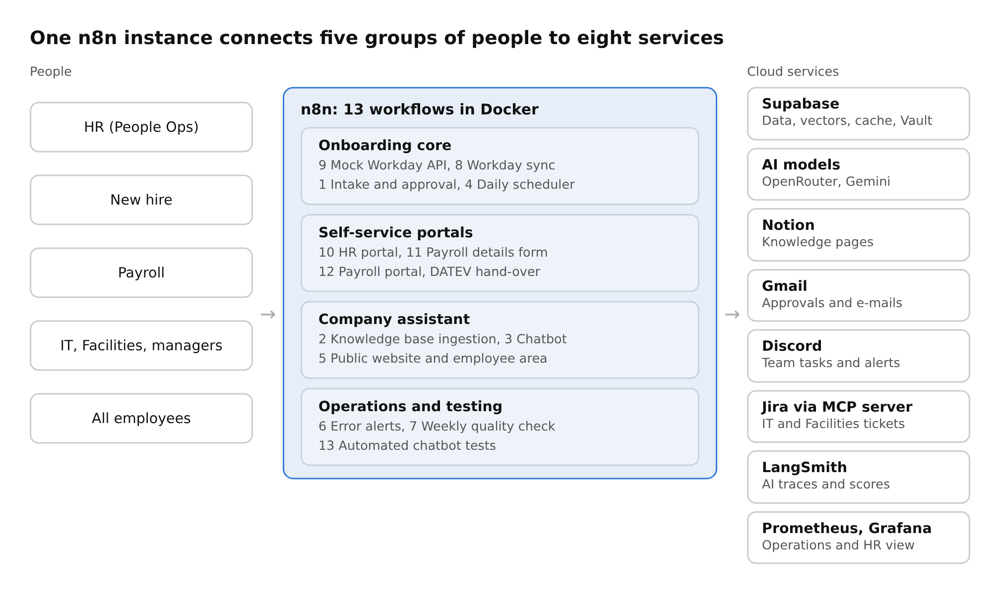

## What it does

| For | The agent |
|---|---|
| **HR (People Ops)** | Picks up new hires from the HR system (mock Workday API), checks them with rules, drafts the welcome e-mail with AI and waits for HR approval |
| **New hire** | Sends a welcome e-mail with a personal code, collects bank and tax details through a secure single-use form, answers questions about their own tasks |
| **IT, Facilities, managers** | Posts their onboarding tasks to Discord, with a daily digest of overdue tasks and a day-1 readiness check |
| **Payroll** | Shows encrypted payroll details in a separate portal, logs every view, records the hand-over to DATEV |
| **All employees** | A company assistant on the website that answers from the knowledge base in English or German, and hands off to People Ops instead of guessing |

**The AI decides nothing about people.** Rules in code check each hire, HR approves every outbound message, and the AI only drafts text and answers from cited documents. Employment is high risk under the EU AI Act, so this boundary is part of the design.

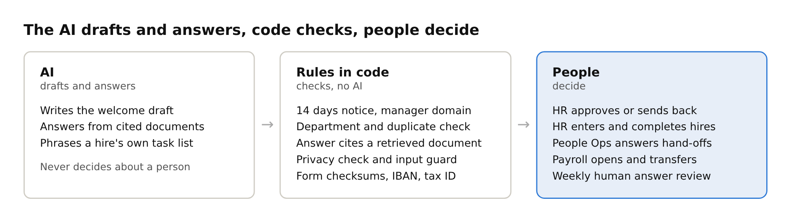

## The flow in one picture

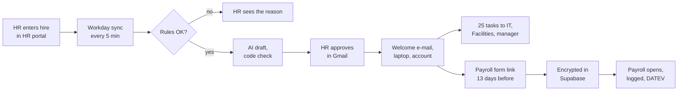

More diagrams, including the UML activity diagram with one lane per role, are in [Architecture](docs/ARCHITECTURE.md).

## Highlights

- **13 n8n workflows**: intake and approval, knowledge base ingestion, company assistant, daily scheduler, website, error alerts, weekly quality check, Workday integration, mock Workday API, HR portal, payroll details form, payroll portal, automated chatbot tests
- **Sensitive data by design**: IBAN, tax ID and social security number encrypted with pgcrypto (AES-256), key in Supabase Vault, HR sees only a masked IBAN, every payroll view logged, no n8n execution data for those workflows
- **Three privacy layers in the assistant**: requests for another person's data refused before the AI, typed ID numbers removed and never stored, answers must cite a retrieved document
- **Memory with limits**: chat memory of the last 8 exchanges per chat, an answer cache for repeated general questions (7 days, never personal or health questions), a cleaned chat log deleted after 90 days. Details in [Architecture](docs/ARCHITECTURE.md#memory-cache-and-chat-storage)
- **Reliability**: answer cache, retries, circuit breaker, rate limits, friendly fallback messages, error workflow to a dev-ops channel, daily health check
- **Observability**: LangSmith for the AI (traces and alerts), weekly quality scores in Supabase, Prometheus and Grafana for n8n operations, and a Grafana business view for HR built on read-only summary views
- **Automated testing**: workflow 13 sends 39 test questions to the assistant, checks every reply and e-mails an Excel report
- **Security**: personal website login for every employee (bcrypt, lockout, login log), separate HR and payroll logins, HMAC-signed (Hash-based Message Authentication Code) page tokens against forged form posts, single-use hashed form links with code lockout

## Results

| Measure | Result |
|---|---|
| Functional and reliability tests | Functional and reliability test cases tested manually, with screenshots of the results. See [Testing](docs/TESTING.md) |
| Automated chatbot tests | 36 of 39 in the first run, **39 of 39 (100%)** after fixing a prompt gap and a citation bug the tests found |
| Weekly answer quality | 30% at first (AI provider limits), 90% after the fixes |
| Chatbot latency | 24 to 33 s on the Gemini free tier, about 2.7 s after moving the chat model to OpenRouter |
| End to end | One hire (Clara Neumann) went from HR entry to DATEV hand-over with one HR approval click |
| Multi-turn chatbot tests | **10 of 10** in 3 real chats after the fix for the top failure mode below (run 13515, 3 Nov 2026) |
| Scenario tests | **26 of 26** pass, including all 10 safety cases and all 3 deliberate break cases. See [Scenario tests](docs/SCENARIO_TESTS.md) |
| Measured in the end-to-end test | One onboarding run takes **17.7 s** of machine time, one assistant answer costs **USD 0.00084** (about 2,300 tokens) and takes about 2 s, 4 of 323 runs failed on the test day (1.24%). See [ROI](docs/ROI.md#measured-in-the-end-to-end-test-2-nov-2026) |
| Business case | About €900 a month saved, build paid back in about 7.5 months (scenario figures for HR time, measured AI cost). See [Business case](docs/BUSINESS_CASE.md) |

**Top failure mode:** in longer chats the AI sometimes answered from chat memory without a new search. The answer check caught it and handed off, so no wrong answer was shown, but People Ops got needless tickets. Fixed with a prompt rule and multi-turn tests, which now pass 10 of 10. A fixed search step is planned. See [Improvement plan](docs/IMPROVEMENT_PLAN.md).

## One hire end to end

Live test on 3 Nov 2026 with the fictional hire **Ayşe Yıldız** (Backend Developer, Engineering, Koeln, start 30 Nov 2026). The Turkish letters also re-test the bias fix: the old code would have proposed `aye.yldz@brewtec.de`.

| Step | What happens |
|---|---|
| 1 | HR completes the hire in Workday (worker 21022). The agent picks it up and it waits for HR approval. |
| 2 | HR gets one approval e-mail. The work e-mail ayse.yildiz@brewtec.de is proposed from the name (bias test T08 live), 25 tasks are planned, the AI draft check passed. |
| 3 | After one click on Approve: the welcome e-mail with the personal code, never a password. |
| 4 | The HR portal shows "In onboarding" and the work account. |
| 5 | IT gets 4 Jira tickets through the Jira MCP server, first name and initial only. |
| 6 | Facilities gets 3 Jira tickets. |
| 7 | The hiring manager gets the task list with due dates in Discord. |
| 8 | The scheduler sends a personal single-use link to the payroll form (token blurred). For the test, the due date was moved to today. |
| 9 | The new hire enters bank, tax and social security details (test data) with the personal code. |
| 10 | Confirmation page. |
| 11 | HR sees only "received" and the masked IBAN DE89 •••• 3000. |
| 12 | In the database, IBAN, tax ID and social security number exist only as AES-256 encrypted bytes (c30d04...). The key is in Supabase Vault. |
| 13 | IT gives Ayşe a website login. The employee website greets her: "Signed in as Ayşe Yıldız". |
| 14 | With her personal code, the assistant lists only her own remaining tasks. The payroll form is no longer open because she submitted it. |
| 15 | In the same chat she asks a policy question. The assistant searches again and cites the leave policy, so the top failure mode is fixed live as well. |

Screenshots of all 15 steps

**1.** HR completes the hire in Workday (worker 21022). The agent picks it up and it waits for HR approval.

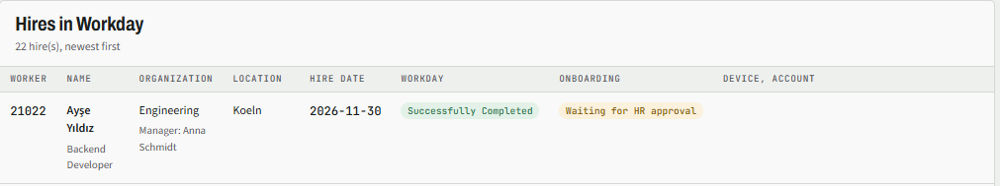

**2.** HR gets one approval e-mail. The work e-mail ayse.yildiz@brewtec.de is proposed from the name (bias test T08 live), 25 tasks are planned, the AI draft check passed.

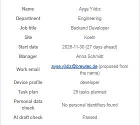

**3.** After one click on Approve: the welcome e-mail with the personal code, never a password.

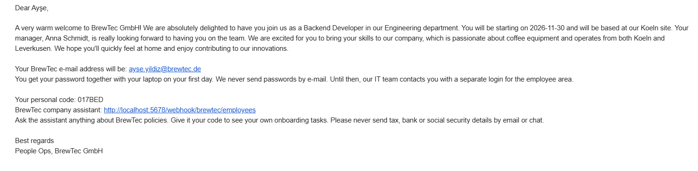

**4.** The HR portal shows "In onboarding" and the work account.

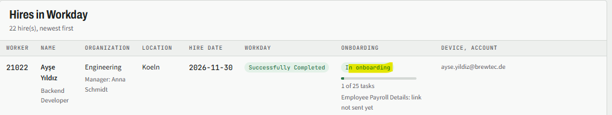

**5.** IT gets 4 Jira tickets through the Jira MCP server, first name and initial only.

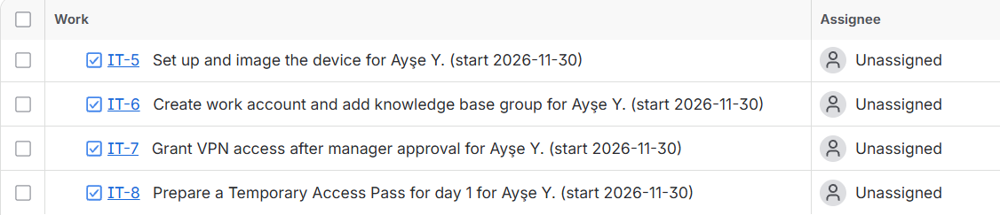

**6.** Facilities gets 3 Jira tickets.

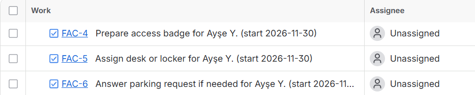

**7.** The hiring manager gets the task list with due dates in Discord.

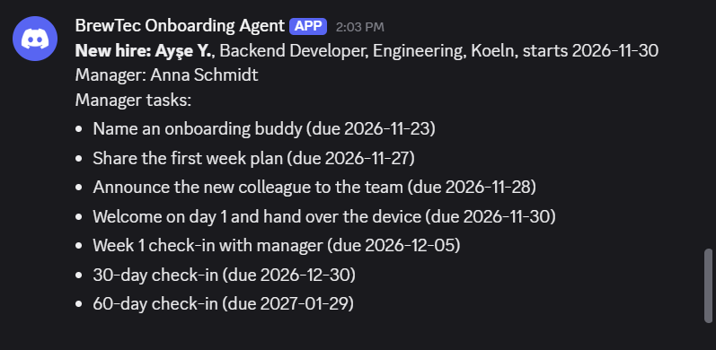

**8.** The scheduler sends a personal single-use link to the payroll form (token blurred). For the test, the due date was moved to today.

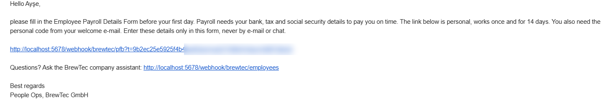

**9.** The new hire enters bank, tax and social security details (test data) with the personal code.

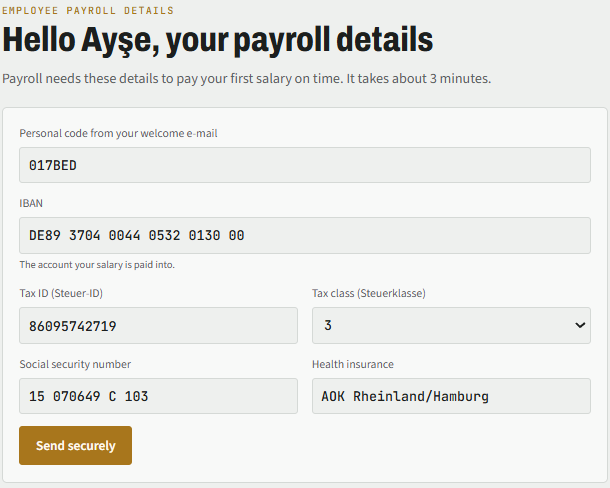

**10.** Confirmation page.

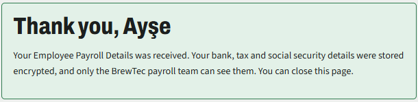

**11.** HR sees only "received" and the masked IBAN DE89 •••• 3000.

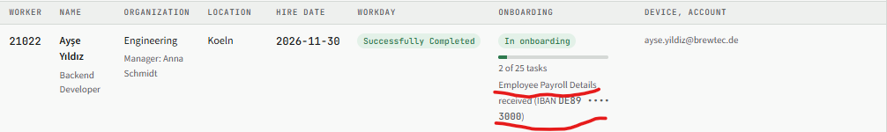

**12.** In the database, IBAN, tax ID and social security number exist only as AES-256 encrypted bytes (c30d04...). The key is in Supabase Vault.

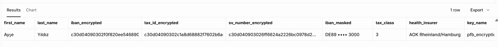

**13.** IT gives Ayşe a website login. The employee website greets her: "Signed in as Ayşe Yıldız".

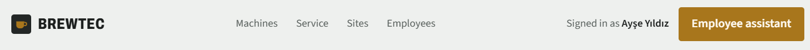

**14.** With her personal code, the assistant lists only her own remaining tasks. The payroll form is no longer open because she submitted it.

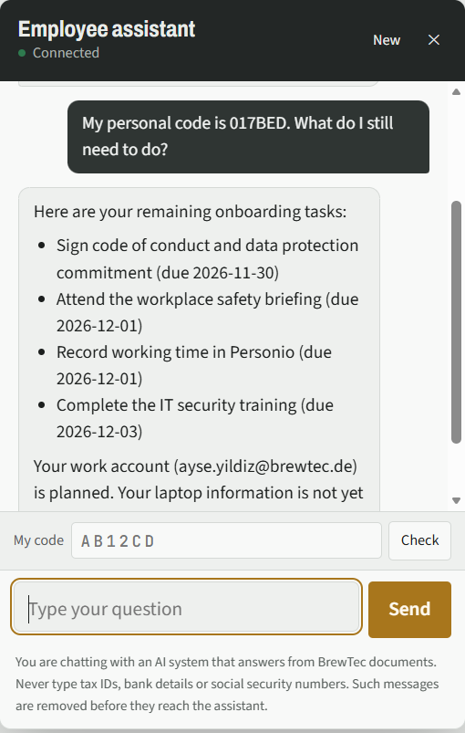

**15.** In the same chat she asks a policy question. The assistant searches again and cites the leave policy, so the top failure mode is fixed live as well.

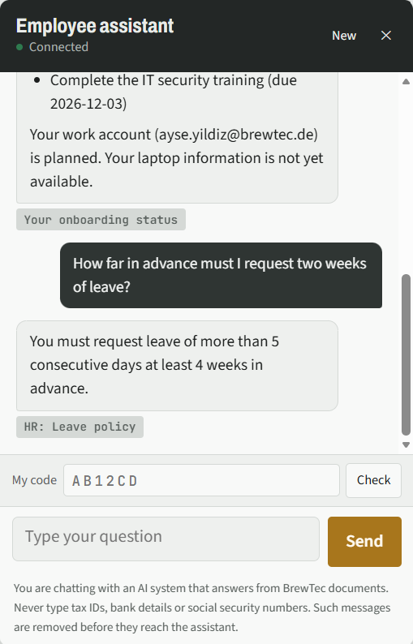

## Limitations and assumptions

- **Fictional company, synthetic data.** BrewTec, its employees, hires and policies are invented. Test hires use placeholder e-mail addresses.
- **Mocks.** Workday is a mock report API (workflow 9) with the real report format. Work accounts and the laptop inventory are simulated in Supabase. DATEV hand-over is a manual "transferred" mark.
- **Assumed, not measured.** The 6 hours per hire today, the 1 hour after automation, 4 hires a month and the €45 hourly cost are scenario figures. Test results, run times and the AI cost are measured (LangSmith, Prometheus and Grafana, 2 Nov 2026).
- **Not reliably quantifiable.** The cost of a hire starting without access and the value of fewer repeat questions are left out of the ROI.
- **Runs on a laptop.** The demo runs in Docker on Windows behind a Cloudflare quick tunnel, so there is no permanent hosted link. Hosting in Germany is planned.
- **Open before real use.** DPIA, works council agreement, bias review of the AI welcome drafts, automatic deletion of payroll details, and a live re-run of the multi-turn tests.

## Tech stack

| Area | Software | Version | Used for |
|---|---|---|---|
| Automation | n8n | 2.37.10 (Docker image `docker.n8n.io/n8nio/n8n:2.37.10`, external task runners) | All 13 workflows |
| Runtime | Docker Desktop | 4.87.0 | Runs n8n, Prometheus and Grafana on Windows |
| Database | Supabase PostgreSQL | 17.11 | Hires, tasks, chat log, answer cache, encrypted payroll details |
| Database | pgvector | 0.8.2 | Vector search for the knowledge base |
| Database | pgcrypto | 1.3 | AES-256 encryption of payroll details, bcrypt website passwords |
| Database | Supabase Vault | Supabase cloud service | Encryption key for payroll details |
| AI | OpenRouter | `google/gemini-2.5-flash` | Chat model of the company assistant (workflow 3) |
| AI | Google Gemini | Default model of the n8n Gemini node (LangSmith shows `gemini-3.6-flash` and `gemini-3.7-flash`) | Welcome e-mail draft and Jira ticket agent (workflow 1) |
| AI | Google Gemini | `gemini-embedding-001` | Knowledge base vectors (workflows 2 and 3) |
| Knowledge base | Notion | Cloud service | Company policy pages |
| Communication | Gmail | Cloud service (OAuth) | Welcome e-mails, HR approvals, reports |
| Communication | Discord | Cloud service (webhooks) | Team tasks, hand-offs and alerts |
| Ticketing | Jira Cloud via mcp-atlassian (MCP server in Docker) | latest image, 2 Nov 2026 | IT and Facilities tickets after HR approval. The server offers only `jira_create_issue` |
| Observability | LangSmith | Cloud service | AI traces and alerts |
| Observability | Prometheus | 2.54.1 (`prom/prometheus:v2.54.1`) | n8n metrics |
| Observability | Grafana | 11.2.0 (`grafana/grafana:11.2.0`) | Operations dashboard and HR business view |
| Access | cloudflared | 2026.10.3 | Public link to the local n8n (quick tunnel) |

## Repository structure

| Folder | Content |
|---|---|
| `workflows/` | The 13 n8n workflows as JSON, ready to import (no credentials inside) |
| `sql/` | Database schema and upgrade scripts, run in this order: `01_schema.sql`, `02_reliability.sql`, `03_privacy_cache.sql`, `04_hris.sql`, `05_payroll.sql`, `06_page_tokens.sql`, `07_grafana_reporting.sql` (optional, for Grafana), `08_website_logins.sql` (personal website logins) |
| `js_nodes/` | The source of every Code node, one file per node |
| `site/` | The company website with the embedded assistant |
| `test_pack/` | Functional test cases, reliability test cases, the 39 automated chatbot tests, knowledge base questions, test hires, SQL checks |
| `monitoring/` | Prometheus and Grafana with two ready-made dashboards (n8n operations, HR business view) |
| `docs/` | Setup guide, architecture, workflows, security, testing, monitoring and deployment |
| `n8n.env.example` | Template for the n8n container settings (copy it outside the repository) |

## Setup

The full step-by-step guide is in [docs/SETUP.md](docs/SETUP.md). In short:

1. Create a Supabase project and run the SQL scripts in the order above. Create the Vault key `pfb_encryption_key`.
2. Start n8n in Docker and create the credentials: Postgres, Supabase API, Gemini, OpenRouter, Gmail OAuth, Notion, two Basic Auth logins (HR and Payroll). LangSmith tracing is switched on with the settings in `n8n.env.example`.
3. Import the 13 workflows, select the credentials on each node, fill the Config nodes (Discord webhooks, URLs), publish them, and set workflow 6 as the error workflow everywhere.
4. Run workflow 2 once to load the knowledge base, then open `/webhook/brewtec` for the public website and `/webhook/brewtec/employees` for the employee area with the assistant.
5. Optional monitoring: start `monitoring/` with `docker compose up -d` and switch on n8n metrics (see [docs/SETUP.md](docs/SETUP.md), section 12).

## Documentation

| Document | Content |
|---|---|
| [Architecture](docs/ARCHITECTURE.md) | Design principle, system overview, UML activity diagram of the whole flow, sequence diagrams, data model, design decisions |
| [Workflows](docs/WORKFLOWS.md) | All 13 workflows: trigger, steps, credentials |
| [Security and governance](docs/SECURITY_AND_GOVERNANCE.md) | Input and output guardrails, payroll encryption, access control, retention, EU AI Act |
| [Testing](docs/TESTING.md) | Test pack, automated tests with a CSV upload, results |
| [Monitoring](docs/MONITORING.md) | Error alerts, LangSmith, weekly quality check, Prometheus and Grafana |
| [Evaluation report](docs/EVALUATION_REPORT.md) | Success criteria, method, results, what testing changed, top failure mode, limits |
| [Demo script](docs/DEMO_SCRIPT.md) | 6-minute talk track, live demo steps, fallback, one input traced through the architecture |
| [Project summary (PDF)](docs/project_summary.pdf) | Two-page written summary of the whole project |
| [ROI and cost estimate](docs/ROI.md) | All inputs labelled measured or assumed, every formula, 12-month projection, sensitivity, production costs. Editable: [roi_calculator.html](docs/roi_calculator.html) |
| [Business case](docs/BUSINESS_CASE.md), [Stakeholder questions](docs/STAKEHOLDER_QA.md), [Technical questions](docs/TECHNICAL_QA.md) | One-page business case with ROI and the ask, prepared answers on cost, risk, alternatives, timeline and the technical defense |
| [Responsible AI](docs/RESPONSIBLE_AI.md) | Bias, hallucination, transparency, human oversight, security, top risk, each with evidence |
| [Scenario tests](docs/SCENARIO_TESTS.md) | 26 scenarios with input, criterion, expected and actual result, score and conclusions |
| [Improvement plan](docs/IMPROVEMENT_PLAN.md) | Top failure mode, fix, two production metrics, scope |
| [Deployment](docs/DEPLOYMENT.md) | Local Docker setup and the plan for a server in Germany |
| [Setup guide](docs/SETUP.md) | Step by step: Supabase, credentials, import, configuration, troubleshooting |
| [architecture.pdf](docs/architecture.pdf), [governance.pdf](docs/governance.pdf) | The full documents as submitted |

## Lessons learned

| Problem found in testing | Fix |
|---|---|
| Gemini free tier rate limits made the assistant unavailable | Answer cache, retries, circuit breaker, fallback message, chat model moved to OpenRouter |
| n8n serves webhook pages in a browser sandbox, so origin checks blocked real users | Single-use links plus personal codes, HMAC-signed (Hash-based Message Authentication Code) page tokens |
| n8n turns relative redirects into `https:///...` and uses 307 | Full redirect URLs built from the request, status 303 |
| Dates from Postgres shown a day early | Dates and times formatted in Europe/Berlin |
| A failed knowledge base rebuild left the assistant empty | New rows written first, old rows deleted only after success |
| An over-broad safety rule blocked legitimate tax ID questions | Rule narrowed to actual numbers, privacy kept by three separate layers |
| In long chats the agent answered from chat memory without a new search, so the answer check handed off correct answers | Prompt rule: search again for every question. The check keeps failing safe if it ever happens again |

## Next steps for a real company deployment

The capstone runs on one PC with a mock HR system. A real rollout at BrewTec would need these steps.

| Area | What it takes |
|---|---|
| **Real Workday** | A Workday sandbox tenant first, then production. An Integration System User (ISU) with only the security groups IT approves, the new-hire report through Workday RaaS or the Workday REST API with OAuth 2.0, and handling for changes after pickup (new start date, rescinded hire). Today the mock API (workflow 9) already uses the same report address and a token |
| **SharePoint Online as knowledge base** | Most German companies keep policies in SharePoint, not Notion. An app registration in Microsoft Entra ID with the `Sites.Selected` permission for the policy site only, documents read through the Microsoft Graph API, delta queries so only changed documents are embedded again, and document permissions respected in the answers |
| **Company sign-in** | Microsoft Entra ID single sign-on (OpenID Connect) for the website and the HR and payroll portals instead of separate passwords, with HR and payroll access managed through Entra groups |
| **Production hosting** | n8n in queue mode (Redis and worker containers, its own Postgres database) on Azure Container Apps or AKS in Germany West Central, or on AWS ECS Fargate in Frankfurt (eu-central-1). A staging copy for tests, secrets in Azure Key Vault or AWS Secrets Manager, workflows in Git with a release pipeline |
| **Live traffic and monitoring** | A web application firewall in front of n8n (Azure Front Door or Application Gateway, or AWS ALB with AWS WAF). Logs, latency and error rates in Azure Monitor with Application Insights and Log Analytics, or in Amazon CloudWatch with X-Ray. Alerts to on-call, and a load test before go-live (Azure Load Testing or k6) |
| **AI inside the EU** | Azure OpenAI in the EU data zone or Amazon Bedrock in Frankfurt, a fallback model, and a cost budget with alerts |
| **Payroll hand-over** | A real DATEV interface instead of the manual "transferred" mark, and automatic deletion of payroll details after the legal retention period |
| **Works council and data protection** | A works council agreement (Betriebsvereinbarung), a DPIA, data processing agreements with every provider, and the EU AI Act duties for a deployer of an employment-related AI system |
