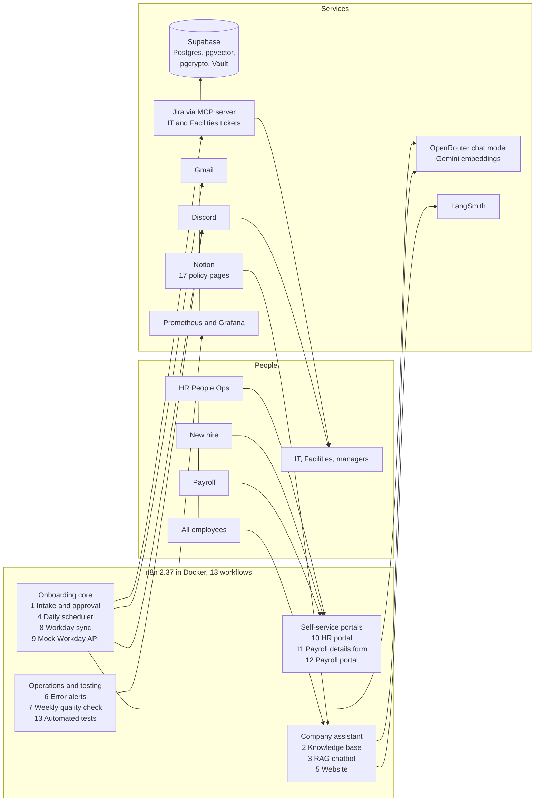
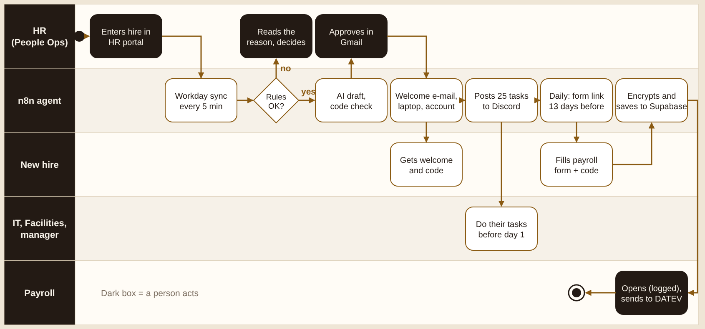
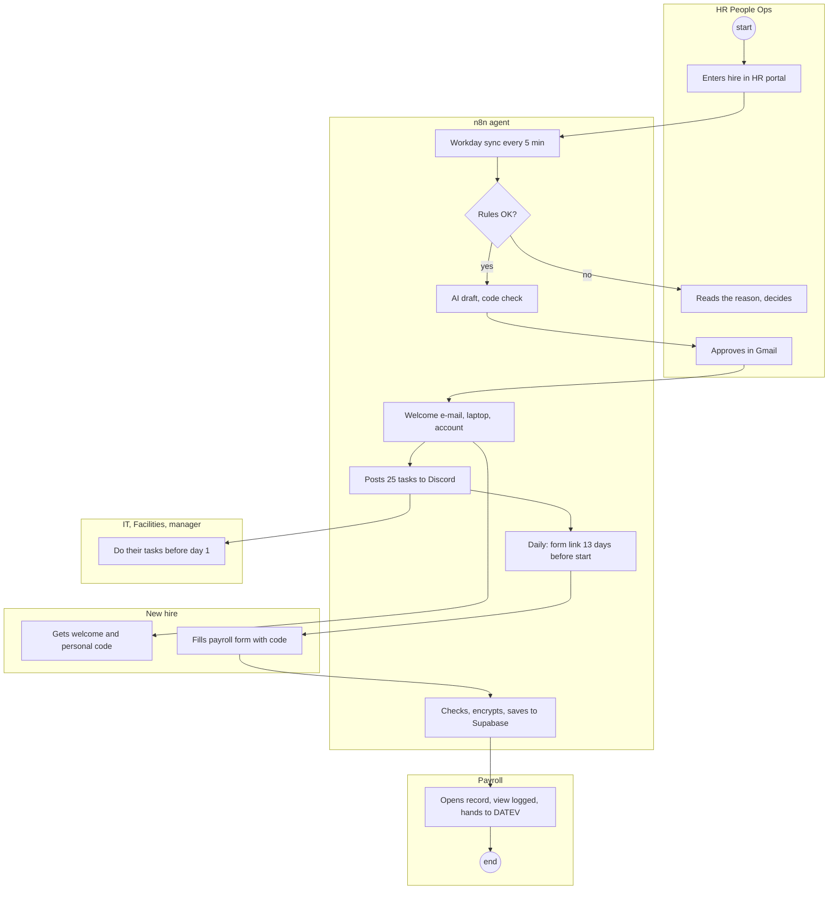
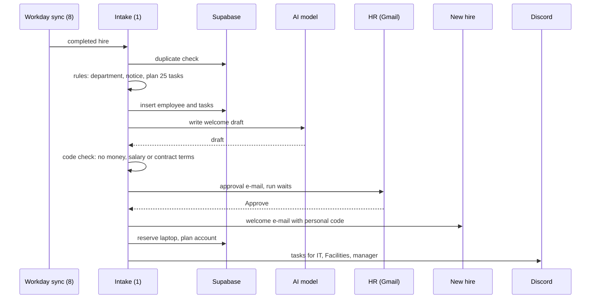
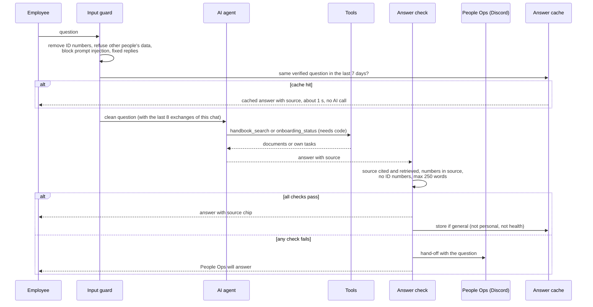
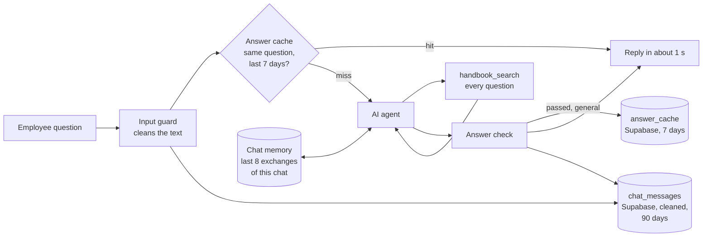
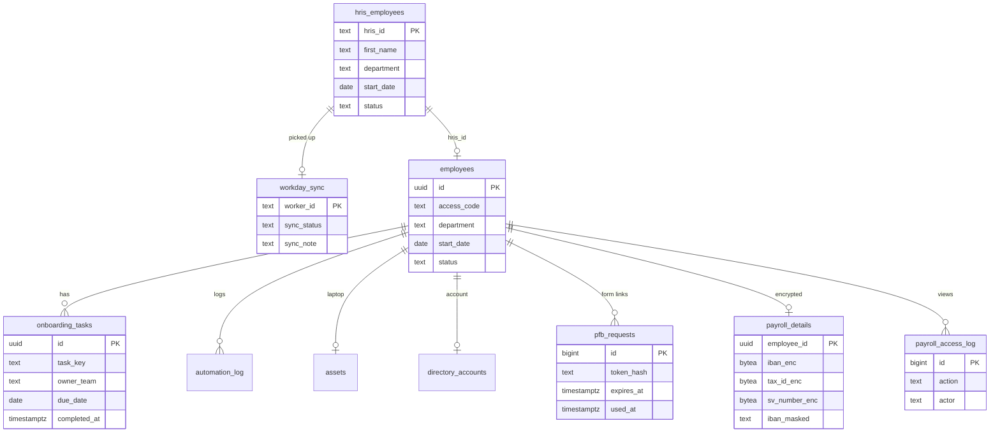

# Architecture

How the BrewTec Employee Onboarding Journey Agent is built: the parts, how data moves between them, the data model and the main design decisions.

Related documents: [Workflows](WORKFLOWS.md) · [Security and governance](SECURITY_AND_GOVERNANCE.md) · [Testing](TESTING.md) · [Monitoring](MONITORING.md) · [Deployment](DEPLOYMENT.md)

## 1. Design principle

**The AI writes text. Code decides. People approve.**

| Decision | Made by |
|---|---|
| Is this hire valid (department, 14 days notice, no duplicate)? | Rules in a Code node |
| Which 25 tasks, for which team, due when? | Rules in a Code node |
| Welcome e-mail text | AI draft, checked by code, approved by HR |
| Does the e-mail go out? | HR, one click in Gmail |
| Answer to an employee question | AI, only from retrieved documents, checked by code |
| Who sees bank and tax details? | Payroll only, every view logged |

Employment is a high-risk area under the EU AI Act (Annex III). Keeping every decision about a person out of the AI is the core of the design.

## 2. System overview



## 3. The whole flow (UML activity diagram)

One hire from HR entry to the payroll hand-over. Each lane is a role, dark boxes are where a person acts.



The same flow as a Mermaid diagram, which GitHub draws from text:



## 4. Data flows

Three flows share one database.

| Flow | Path |
|---|---|
| **Onboarding** | HR portal (10) → `hris_employees` → Workday report API (9) → Workday sync (8) → Intake (1): rules, AI draft, code check → HR approval in Gmail → welcome e-mail, laptop, account, Discord tasks, Jira tickets for IT and Facilities through the Jira MCP server (create issue only) |
| **Payroll data** | Daily scheduler (4) → single-use form link e-mail → Payroll form (11): checksums → `payroll_details` encrypted with the Vault key → Payroll portal (12): decrypt one record, log the view → DATEV hand-over |
| **Company assistant** | Notion (17 pages) → Ingestion (2), nightly → `handbook_documents` (about 97 chunks) → Website chat (5) → Assistant (3): input guard, AI agent with two tools, answer check → reply or hand-off to People Ops |

### HR approval (sequence)



### Company assistant (sequence)



### Memory, cache and chat storage

The assistant has three kinds of memory. Each has its own purpose and its own limit.



| | Chat memory | Answer cache | Chat log |
|---|---|---|---|
| **Purpose** | Follow a conversation | Answer repeated questions fast, without the AI | Audit, hand-offs, figures for HR |
| **Where** | n8n working memory (`Chat memory` node) | Supabase `answer_cache` | Supabase `chat_messages` |
| **Scope** | One chat window | Everyone | Everyone |
| **Limit** | Last 8 exchanges (8 questions and 8 answers) | Reused for 7 days (`cache_days`), deleted after 30 days | Deleted after 90 days (`chat_retention_days`) |
| **Lost when** | n8n restarts, or the user clicks **New** | The knowledge base is rebuilt after a Notion change | Retention clean-up in workflow 4 |

**When the cache answers:** the same words as an earlier question (capital letters and punctuation ignored), the earlier answer passed every check and cited a document, at least 4 words and at most 300 characters.

**Never cached:** hand-offs, health or other sensitive questions, questions with a personal code, answers about someone's own tasks, follow-ups that start with "and", "also", "what about", "und" or "aber", and test sessions (`qc-`).

**What the chat log stores:** the cleaned question, the reply, the cited source or `handoff: <reason>`, and the flags `handoff` and `blocked`. ID numbers become `[removed: personal data]`, e-mail addresses, phone numbers and codes become `[email]`, `[phone]` and `[code]`, health questions become `[personal health-related question, text not stored]`, and answers about someone's own tasks are not stored. Test sessions are not logged.

**Finding from testing:** in a long chat the agent sometimes answered from its chat memory without a new search. The answer check could not verify the answer (`no retrieval was recorded`) and handed it off, which is safe but unnecessary. Rule 1 of the system prompt now requires a new search for every question.

Useful queries:

```sql
-- All chat messages, newest first
select created_at, session_id, user_message, reply, sources, handoff, blocked
from chat_messages order by created_at desc;

-- Hand-offs with the reason
select created_at, user_message, sources from chat_messages
where handoff = true order by created_at desc;

-- Cached answers and how often they were reused
select question, sources, hits, created_at, last_hit_at
from answer_cache order by last_hit_at desc nulls last;
```

## 5. Data model



Other tables: `handbook_documents` (chunks with 3072-dimension Gemini embeddings), `chat_messages`, `answer_cache`, `code_attempts`, `quality_checks`, `automation_log`, `assets` (14 seeded laptops), `directory_accounts`.

Views: `onboarding_overview`, `workday_sync_overview`, and seven `reporting.*` views for Grafana (`hires_by_month`, `hire_status`, `task_progress`, `day1_readiness`, `payroll_forms`, `chat_daily`, `automation_daily`).

## 6. Key design decisions

| Decision | Why |
|---|---|
| **Mock Workday report API** (workflow 9) instead of the n8n form | In a real company hires start in the HR system. The mock copies the Workday custom report URL and needs a bearer token. Moving to a real tenant changes the URL and credential, not the logic |
| **Only `Successfully Completed` hires** start onboarding | Matches the Workday hire business process. `In Progress` waits for HR |
| **Rules in Code nodes**, not in the prompt | Readable, testable, same result every time |
| **Gmail send-and-wait** for approval | HR approves in the tool they already use. The run pauses until HR clicks |
| **Personal code** for the assistant | An employee only sees their own tasks. Lockout after wrong tries |
| **pgcrypto AES-256 with the key in Supabase Vault** | Bank and tax data are never stored in clear text and never pass through the AI, Discord, LangSmith or n8n execution logs |
| **HMAC-signed (Hash-based Message Authentication Code) page tokens** on HR and payroll portals | n8n serves webhook pages in a sandbox, so origin checks fail. Signed tokens stop forged form posts |
| **Knowledge base rebuild with run id** | New chunks are written first, old ones deleted only after success, so the assistant is never empty |
| **OpenRouter for chat, Gemini for embeddings** | Gemini free tier rate limits made the assistant slow (24 to 33 s). OpenRouter brought it to about 2.7 s |

## 7. Scaling and production path

| Today (capstone) | Production |
|---|---|
| n8n on a laptop in Docker, public link through trycloudflare | Always-on server in Germany with HTTPS, see [Deployment](DEPLOYMENT.md) |
| Basic Auth for HR and payroll | Company single sign-on |
| Mock Workday API | Real Workday tenant through an integration system user (OAuth) |
| Free AI tiers | Paid tier with a fallback model |
| Manual retention | Automatic deletion of payroll details after the legal retention period |
| The AI decides when to search the knowledge base | A fixed search step before the AI on every question, see [Improvement plan](IMPROVEMENT_PLAN.md) |
| Notion knowledge base | SharePoint Online through Microsoft Graph |
