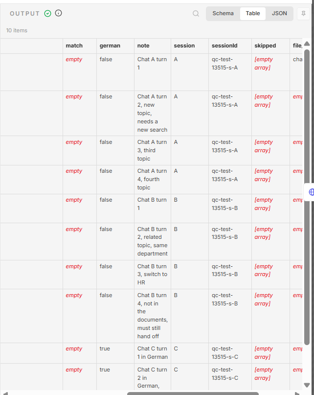
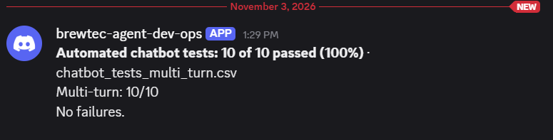

# Evaluation report

What was tested, how, against which criteria, what came out, and what that means for the system's limits. The per-test records are in [Scenario tests](SCENARIO_TESTS.md). How to run the tests yourself is in [Testing](TESTING.md).

## 1. Success criteria

Defined in Sprint 1 and tightened in Sprint 3:

| Criterion | Target | How it is measured |
|---|---|---|
| People Ops hands-on time per hire | From about 6 h to 1 h or less | Timing sheet `test_pack/time_saved_hires.csv` |
| Outbound messages without a recorded HR approval | 0 | `hr_approval` rows against sent e-mails, scenario tests |
| Knowledge base questions answered with the right source, or correctly handed off | 90% or more | 39 automated chatbot tests, 10 weekly golden questions |
| Personal identifiers stored in logs or chat history | 0 | Scenario tests T07, T11, T16, chat log checks |
| Every hire gets a correct work e-mail, whatever the language of the name | Always | Scenario tests T02, T08, T09 |

## 2. Method

Four layers, each catching a different kind of problem:

| Layer | What it covers | How |
|---|---|---|
| **Scenario tests (formal set)** | Rules, guardrails, break and safety cases | 26 scenarios with all eight fields. 22 run the real Code nodes from the exported workflows with fixed inputs. 4 are live runs with the real AI |
| **Automated chatbot tests** | Answer quality, citations, guards, language, edge cases | Workflow 13: upload a CSV, the live assistant answers every question, code checks source, key fact and language, an Excel report arrives by e-mail |
| **Weekly quality check** | Drift over time | Workflow 7: 10 golden questions every Monday, plus 5 real answers for a human to read |
| **Manual tests** | Portals, form, scheduler, end to end | Functional and reliability test cases in `test_pack/`, run by hand with screenshots |

**Scoring:** pass rate against the stated criterion, with one hard rule: every safety case must pass, because one miss there means leaked personal data or an invented answer reaching an employee.

## 3. Results

| Measure | Result | Type |
|---|---|---|
| Scenario tests | **26 of 26**: typical 5/5, variation 4/4, edge 4/4, break 3/3, safety 10/10 | measured, 1 Nov 2026, L02 re-run 2 Nov 2026 |
| Multi-turn chatbot tests | **10 of 10** in 3 real chats of 2 to 4 turns, every later question searched again with its own source (run 13515) | measured, 3 Nov 2026 |
| Automated chatbot tests | 36 of 39 on the first run, **39 of 39** after the fixes (run 12681, 29 Oct 2026), again **39 of 39** on 2 Nov 2026 (run 13356) | measured |
| Weekly quality score | 30% at first (AI rate limits), **90%** after the fixes | measured |
| Chatbot answer time | 24 to 33 s on the Gemini free tier, about **2.7 s** after moving the chat model to OpenRouter | measured |
| End to end | One hire (Clara Neumann) from HR entry to DATEV hand-over with one approval click. On 2 Nov 2026 more hires ran through HR portal, Workday sync, approval, welcome e-mail, Notion, Discord, Jira tickets, payroll form and assistant | measured, with screenshots |
| Run time and AI cost | One onboarding run **17.7 s** of machine time (Prometheus). One assistant answer about 2 s and **USD 0.00084** (LangSmith). 4 of 323 runs failed on the test day, 1.24% (Grafana) | measured, 2 Nov 2026 |
| Outbound without approval | 0 in every run. The send-and-wait node blocks the flow until HR clicks | measured |
| Personal identifiers stored | 0 in the scenario tests (T07, T11, T16) | measured |
| People Ops time per hire | Not yet timed with real hires. 6 h and 1 h are scenario figures. The HR clicks in the 2 Nov test took about 5 minutes per hire (observed) | **assumed** |

The manual functional and reliability rounds are partly recorded in `test_pack/`. A test without a recorded result is not counted as passed.

## 4. What testing changed in the design

| Found by | Problem | Change |
|---|---|---|
| Repeated automated runs | A correct answer citing two files in one bracket was handed off | The answer check and the website accept both citation formats |
| First automated run | A mixed question exposed a gap in prompt rule 5 | Rule rewritten |
| Bias test T08, T09 | Turkish, Polish and Serbian names lost letters in the work e-mail, a Cyrillic name became `.@brewtec.de` | Unicode-based name conversion, neutral address for non-Latin names |
| Live test with the free tier | Rate limits made the assistant unavailable | Answer cache, retries, circuit breaker, chat model on OpenRouter |
| Grafana dashboard | 70% failure rate from an unrelated workflow | Workflow unpublished, failure rate under 5% |
| Round 2 chatbot tests | Longer chats skipped the search (top failure mode, below) | Prompt rule, multi-turn tests in workflow 13 |
| End-to-end test, 2 Nov | "When do I get my first salary?" was refused as a request for someone else's salary | The privacy guard now knows words like first, next and monthly before "salary". Retested: answered with the payroll guide as source, requests for another person's salary still refused |
| End-to-end test, 2 Nov | A hire stopped by the 14-day rule was reported as "Workflow failed" in the dev-ops channel | Rule stops now get their own alert text: expected behaviour, nothing broken |
| End-to-end test, 2 Nov | Wrong website logins only showed the browser login box again, with no message | A "Wrong e-mail or password" page with a Try again button. A stored wrong login is not counted twice |
| Form tests in the browser | n8n's page sandbox broke the origin check | Single-use links with a personal code, HMAC-signed page tokens |

## 5. Top failure mode

**In longer chats the AI sometimes answered from chat memory without a new search.** The answer check found no recorded search and handed off. No employee saw a wrong answer, but People Ops got tickets for questions the documents answer. The root cause is that the model decides when to call the search tool. The automated tests could not see it because every question ran in its own chat.

Status: a prompt rule and multi-turn tests are in place. A first multi-turn run on 2 Nov 2026 (run 13401) did not count: the session support was not yet live in workflow 13, so each question still ran in its own chat. After deploying it, run 13515 on 3 Nov 2026 sent the questions as 3 real chats (session IDs qc-test-13515-s-A, -B, -C) and all 10 passed, every later question with its own source. A live chat also answered several questions with a source each, so scenario L02 is now marked Pass.

Evidence for run 13515: the `Test cases` output shows one session ID per chat, and the Discord report shows 10 of 10. Result file: [`chatbot_test_results_multi_turn_2026-11-03.xlsx`](../test_pack/results/chatbot_test_results_multi_turn_2026-11-03.xlsx).

 The structural fix, a fixed search step before the AI, is still in the [Improvement plan](IMPROVEMENT_PLAN.md), because a prompt rule depends on the model following it.

## 6. Limits of the current system

- **Partial checking:** the answer check proves that sources and numbers are real, not that every sentence is true. The control is the weekly human review of 5 real answers.
- **Business case not measured yet:** the time saving rests on scenario figures. Timing 5 hires is the first pilot task.
- **Mocks and synthetic data:** Workday is a mock, work accounts and laptops are simulated, all people and documents are fictional.
- **Not yet bias-tested:** the AI welcome drafts have not been compared across names.
- **Runs on a laptop:** behind a temporary tunnel, so availability depends on the PC.

## 7. Conclusion

The guardrails do what they were designed for: every safety and break case passed, and the safety checks rely on code rather than on the model behaving. The two real defects found late, the name bug and the skipped search, were both cheap to test once someone looked. That is the main lesson for the next version: test longer conversations and names from different languages from the start. The system is ready for a supervised pilot, not for unsupervised production.
